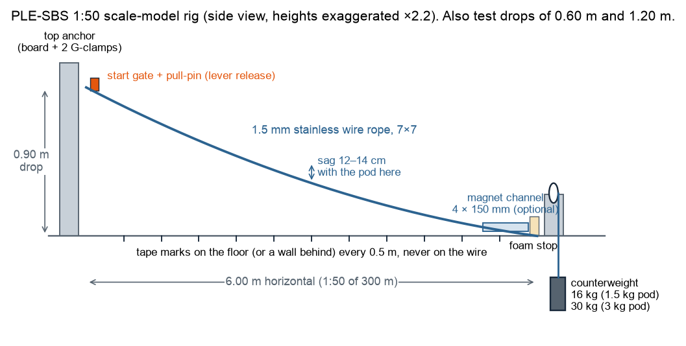
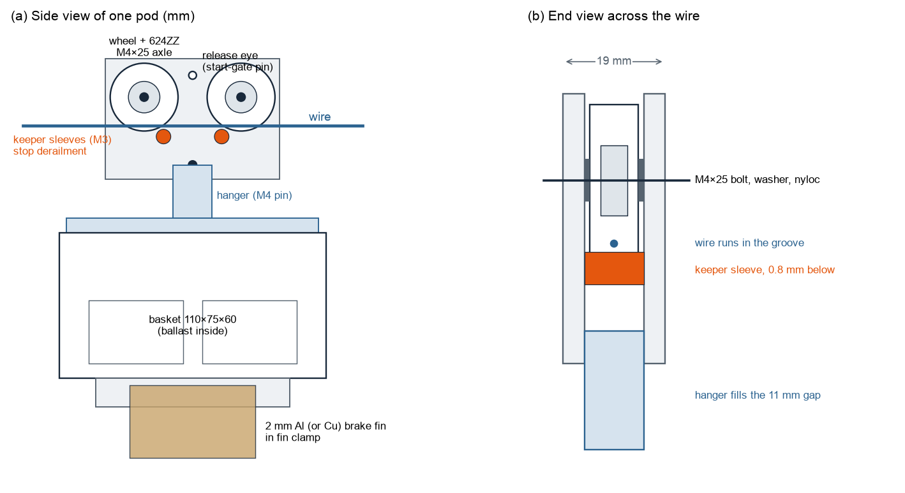

# Scale-model rig: bill of materials, 3D-printed parts and assembly

A 1:50 working model of the PLE-SBS slidewire: a **6.00 m horizontal span with a 0.90 m drop** (the full-size design is 300 m and 45 m), two pods so series runs can be tested, and an optional magnetic-brake section. Test plan and data recording: [scale-model-protocol.md](scale-model-protocol.md).

## 1. 3D-printed parts

All files are in `cad/stl/` and are generated by `cad/make_parts.py` (edit the parameters at the top and re-run to resize). Preview: `cad/parts_preview.png`.

| File | Qty | What it does | Print orientation | Approx. filament |
|---|---:|---|---|---:|
| `wheel_x4.stl` | 4 | V-groove wheel that rides on the wire; a 624ZZ bearing presses into the open side | flat, lip side down | 2 g each |
| `trolley_plate_x4.stl` | 4 | Side plates; two per trolley, identical (holes for 2 axles, 2 keepers, hanger pin, release eye) | flat | 10 g each |
| `keeper_sleeve_x4.stl` | 4 | Spacer under the wire, 0.8 mm below it, so the trolley cannot jump off | upright | < 1 g each |
| `hanger_x2.stl` | 2 | Joins the basket to the trolley's bottom M4 pin; fills the 11 mm gap between plates | flat (as exported) | 8 g each |
| `basket_x2.stl` | 2 | Open-sided pod, 110 × 75 × 60 mm, holds 0.5–3 kg of ballast | upright, open top up, no supports | 46 g each |
| `fin_clamp_x2.stl` | 2 | Bolts under the basket floor and holds the 2 mm brake fin | slot face down | 7 g each |
| `magnet_channel_150mm_x4.stl` | 4 | Brake track: two facing rows of seven 20 × 10 × 5 mm magnets, 6 mm gap (optional) | flat, base down | 37 g each |
| `start_gate_x1.stl` | 1 | Holds the first pod at the top until the pin is pulled | base down | 9 g |
| `start_pin_x2.stl` | 2 | Pull-pin with ring; pulling it is the model's version of the occupant's release lever | flat | 1 g each |

Total about 400 g of filament including spares and failed prints.

**Print settings:** PETG (preferred; tougher) or PLA+, 0.4 mm nozzle, 0.2 mm layers, 4 perimeters, 40 % gyroid infill (wheels and plates 60 %), no supports needed. Before printing four wheels, print one and test the bearing: it should press in firmly by hand or with a vice. If it is loose, reduce `FIT` in `cad/make_parts.py` from 0.15 to 0.05; if it will not go in, raise it to 0.25.

## 2. Hardware and materials

Prices are approximate Indian retail prices (June 2026) for planning only. Bearings, fasteners, magnets and filament are sold by online robotics and maker shops; rope, clips, pulleys and clamps by any hardware store.

| # | Item | Specification | Qty | Approx. ₹ |
|---:|---|---|---:|---:|
| | **Rig** | | | |
| 1 | Stainless steel wire rope | 1.5 mm, 7×7 construction, breaking load ≈ 1.5–2 kN | 10 m | 350 |
| 2 | Wire rope clips or crimp ferrules | for 1.5–2 mm rope | 6 | 150 |
| 3 | Wire rope thimbles | 2 mm | 2 | 60 |
| 4 | Top anchor | 12 mm plywood board 300 × 150 mm + two 100 mm G-clamps (or two wall eye-bolts) | 1 set | 500 |
| 5 | Pulley for the low end | single sheave 25–40 mm, ball bearing, with a clamp or bracket | 1 | 250 |
| 6 | Counterweight | bucket filled with sand or bricks to 16 kg (1.5 kg pod) or 30 kg (3 kg pod), S-hook | 1 | 150 |
| 7 | Turnbuckle (alternative to 5–6) | M6 hook–eye | 1 | 150 |
| 8 | Foam end stop | 50 mm EPE foam block or an old cushion | 1 | 150 |
| | **Two pods** | | | |
| 9 | Ball bearings | 624ZZ, 4 × 13 × 5 mm | 6 (2 spare) | 240 |
| 10 | M4 bolts, nyloc nuts, washers | M4 × 25 (4 axles + 2 hanger pins) | 6 + 6 + 12 | 120 |
| 11 | M3 bolts and nyloc nuts | M3 × 16 (keepers ×4), M3 × 12 (hanger ×4), M3 × 20 (fin clamp ×6) | 14 + 14 | 150 |
| 12 | Ballast | steel washers (M10–M12) or coins, bagged in 0.5 kg lots | 3 kg | 350 |
| 13 | Cable ties | 150 mm, to tie ballast down through the floor slots | 20 | 40 |
| 14 | 3D-printing filament | PETG, 1.75 mm | ≈ 0.4 kg | 550 |
| | **Magnetic-brake demo (optional)** | | | |
| 15 | Neodymium block magnets | N42, 20 × 10 × 5 mm, magnetised through the 5 mm thickness | 56 | 1,100 |
| 16 | Brake fins | 2 mm aluminium sheet, cut to 50 × 30 mm (one per pod); optional 2 mm copper for comparison | 2 (+1) | 150 (+300) |
| 17 | Mounting plank | 18 mm plywood or MDF, 700 × 60 mm, + M4 wood screws | 1 + 16 | 250 |
| 18 | Instant glue | cyanoacrylate, to fix the magnets in their pockets | 1 | 60 |
| | **Measuring and safety** | | | |
| 19 | Digital scale | 5 kg × 1 g | 1 | 400 |
| 20 | Tape measure | 10 m | 1 | 250 |
| 21 | Coloured tape | for 0.5 m marks on the floor or wall | 1 roll | 60 |
| 22 | Safety glasses | | 2 | 200 |
| 23 | Phone with 240 fps slow motion; free video-analysis app (e.g. Tracker, Open Source Physics) | | existing | 0 |

**Approximate total:** about ₹4,000 without the magnetic-brake demo, about ₹5,900 with it.

## 3. Assembly

1. **Wheels.** Press a 624ZZ bearing into the open side of each wheel until it sits on the lip. It must spin freely on an M4 bolt.
2. **Trolley.** Stack plate, washer, wheel, washer, plate on two M4 × 25 bolts with nyloc nuts. Tighten until the plates are parallel with an 11 mm gap and the wheels still spin.
3. **On the wire.** Set the wheels on the wire, then fit the two keeper sleeves under the wire with M3 × 16 bolts. The sleeves must not touch the wire (0.8 mm gap) and the trolley must not be able to lift off.
4. **Pod.** Bolt the hanger's two lugs inside the basket's end walls (M3 × 12). Put the hanger tab between the trolley plates and pass an M4 × 25 bolt through the bottom hole of both plates and the tab. The basket should swing freely along the wire.
5. **Fin (if using the brake).** Drill a 3.3 mm hole 4 mm from the top edge of a 50 × 30 mm fin, slide it into the fin clamp's slot, and cross-bolt it. Bolt the clamp under the basket floor (2 × M3 × 20).
6. **Rig.** Fix the top end of the rope to the anchor with a thimble and two clips. Set the high point 0.90 m above the low pulley and 6.00 m away horizontally. Run the rope over the pulley to the counterweight. Park a loaded pod at mid-span and adjust the counterweight until the sag there is 12–14 cm.
7. **Start gate.** Screw the base to the anchor board just below the top anchor and shim it until the pull-pin slides through the upright into the trolley's release eye.
8. **Magnet channel (optional).** Glue magnets into the pockets: alternate N and S along each row, and face N opposite S across the gap so the field crosses the gap. Screw the four segments end to end on the plank. Mount it under the last 0.6 m of wire so the fin runs centred in the 6 mm gap, about 8 mm deep.
9. **Foam stop.** Put the foam block where the wire meets the pulley bracket.
10. **Before every session**, weigh each pod (trolley + basket + ballast) and record it as `mass_kg`.

## 4. Counterweight for the right sag

The model should sag in the same proportion as the full-size rope (about 2.3 % of the span, 12–14 cm at mid-span with the pod there). Tension T ≈ 11 × pod weight:

| Pod mass (with ballast) | Counterweight (≈ tension) |
|---:|---:|
| 0.5 kg | 5–6 kg |
| 1.5 kg | 16 kg |
| 3.0 kg | 30–33 kg |

Change the counterweight when you change the ballast, or keep one ballast per session. Always measure and record the sag.

## 5. Safety

- Wear glasses whenever the rope is under tension; never stand in line with the rope.
- Keep fingers away from the wheels and the start gate when the pin is pulled.
- N42 magnets snap together hard enough to pinch skin and chip; handle one at a time and keep them away from phones and cards.
- The counterweight hangs at floor level; keep feet clear and never stand under it.
