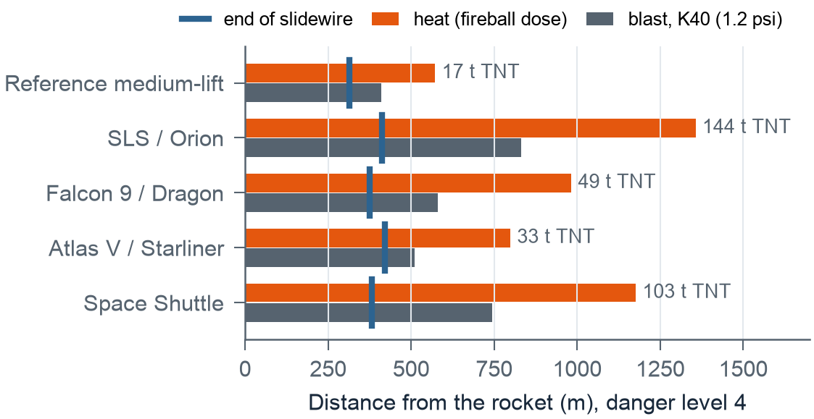
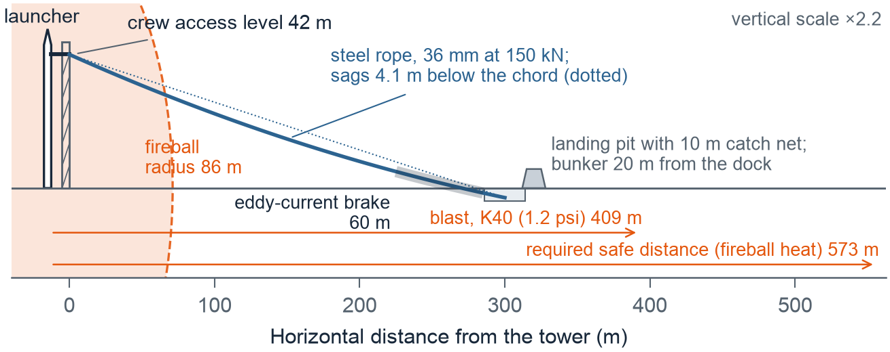
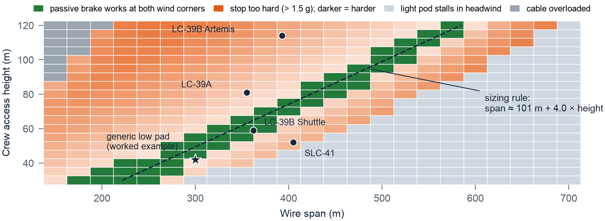
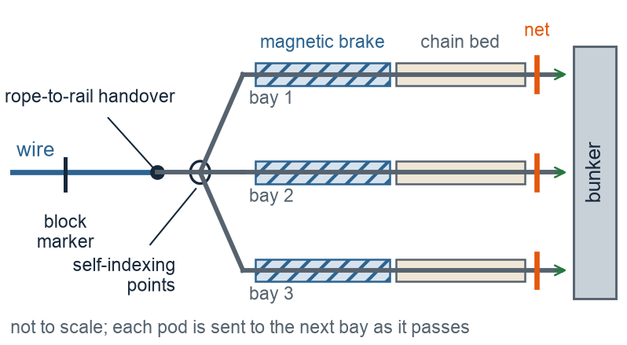

# 1. Introduction

A crewed launch pad is most dangerous between propellant loading and lift-off. The crew are strapped into the capsule, a close-out team is working in the white room at the end of the crew access arm, and hundreds of tonnes of propellant sit a few metres away. If a leak, a fire or a tank over-pressure is detected, everyone at the top of the tower must get beyond the reach of a possible fireball and blast wave within minutes, and they cannot rely on electric lifts.

NASA's answer since the Apollo era has been the **slidewire**: steel ropes from the crew access level to a landing area hundreds of metres away, ridden down in baskets under gravity. The Shuttle-era system at Launch Pad 39B ran from the 195-ft level of the fixed service structure to a landing zone 1,200 ft away. It was required to clear everyone within two minutes, in winds up to 34 knots [3]. Its seven baskets each carried three people [4], reached about 55 mph and made the trip in about half a minute [5]. The Artemis system at the same pad has four baskets. Each takes up to five people or 1,500 lb from the 274-ft level of the mobile launcher, about 375 ft above the ground, down 1,335-ft cables [1], at 40–55 mph [6], braked by eddy-current (magnetic) brakes of the kind used on roller coasters [2]. At SLC-41, riders sit in individual seats on four wires and control their own brakes [7].

Each was engineered for one pad, but new crewed launch sites have towers of very different heights. This paper develops **PLE-SBS** (Pre-Launch Emergency: The Slidewire Basket System) as a system concept *and* a sizing method that works for any rocket on any pad. To make the method concrete, it is carried all the way through a worked example: a reference medium-lift crewed launcher (two large solid boosters, a hypergolic liquid core and a cryogenic upper stage) on a generic low-tower pad whose crew access level is only 42 m above the ground, about a third of the Artemis height.

**Approach.** The study moves from the problem to a tested design. Section 2 turns the safety problem into requirements that any design can be checked against. Section 3 builds the physical models. Section 4 turns them into a simulator and a scale-model test rig. Section 5 runs the system, checks it against the NASA systems, feeds every failure back into the design, and derives the sizing rule for any pad. Section 6 improves the design for a failed brake and a single shared wire, and Section 7 lists the materials. Every figure can be reproduced in the open simulator [16].

# 2. The problem and the requirements

**Stakeholders.** The flight crew, the close-out crew at the crew access level, the range-safety and pad-operations teams who decide when to evacuate, and the engineers who must build and maintain the system, often on a coastal site with salt air and seasonal storms.

**Scenario.** An alarm sounds. The close-out crew are already on the platform. The flight crew must unstrap and leave the capsule (assumed 60 s), walk single-file along the access arm, board pods, ride the wire, leave the pod at the terminus and reach shelter. The clock stops when the last person is protected in the bunker. The worked example has a crew of 3 and a close-out team of 6.

**Danger levels.** Real procedures define hazard states that cannot be found in public documents. I therefore defined five illustrative danger levels (Table 1). Each sets two things: the fraction of propellant assumed to take part in an explosion, and the time between the alarm and a possible event (the "warning window"). These values are my assumptions, chosen so that level 4 matches the Shuttle's two-minute requirement. The simulator lets the user change them.

| Level | Scenario | Propellant taking part | Warning window |
|:--:|:------------------------------|:-----------:|:----------:|
| 1 | Precautionary hold, vehicle stable | 25% | 600 s |
| 2 | Contained leak, no ignition | 50% | 300 s |
| 3 | Major leak, vapour cloud forming | 75% | 180 s |
| 4 | Fire on the pad or tank over-pressure | 100% | 120 s |
| 5 | Imminent structural failure | 100% | 60 s |

: Table 1. Danger levels used in this study (author's assumptions).

| # | Requirement | Source |
|:--:|:--------------------------------------|:------------|
| R1 | Everyone at the crew access level protected within the warning window, judged at the 95th percentile (P95), not the average | design choice |
| R2 | Works with no electrical power (gravity drive, passive brakes) | heritage [3], [7] |
| R3 | Works in along-wire wind up to 17.5 m/s (34 kn) in either direction | Shuttle requirement [3] |
| R4 | Peak deceleration ≤ 1.5 g for seated, belted occupants | assumption, below [15] |
| R5 | No pod stalls, no pod closes within 5 m of another, dock cleared before the next pod arrives | safety |
| R6 | Cable tension ≤ minimum breaking strength / 5 | assumption |
| R7 | Terminus outside the fireball; shelter rated for the overpressure there | safety |

: Table 2. Requirements.

# 3. The physical models

## 3.1 How far is far enough?

Liquid propellants that mix before igniting can explode. Safety engineers express this as an equivalent mass of TNT, $W$. Under DoD rules, LOX/LH$_2$ counts as the larger of 14% of the propellant mass and $8W^{2/3}$ (masses in lb), and LOX/RP-1 as 10% [8]. I found no published standard for LOX/methane or hypergolic propellants, so I assume 20% and 10% for these. Solid HTPB and PBAN boosters are classed as a mass-fire hazard rather than a detonation hazard. I give them no blast yield by default, and the user can change this. The blast distance follows Hopkinson–Cranz cube-root scaling [12]:

$$R_\text{blast} = K\,W^{1/3}\quad(\text{ft},\ \text{lb}),$$

with $K = 40$ giving about 1.2 psi, the DoD inhabited-building criterion [9]. The second hazard is heat. NASA's propellant-explosion tests showed that fireball size and duration scale with the propellant mass, whatever the propellant combination [10]. High's correlations, on the total propellant mass $M$ in kg, give a fireball diameter $D = 3.86M^{0.32}$ m and duration $t = 0.299M^{0.32}$ s [11]. I model the heat flux at distance $r$ as $q = E\,(R_\text{fb}/r)^2$ with surface emissive power $E = 200$ kW/m². A person is safe when the thermal dose $q^{4/3}t$ stays below 100 (kW/m²)$^{4/3}$s, between the pain threshold (92) and the first-degree-burn threshold (105) [13]. The required safe distance is the larger of the two.

For the reference launcher (two solid boosters holding 410 t of propellant, 115 t of hypergolic propellant in the liquid core and 28 t of LOX/LH$_2$ in the upper stage, representative values for a vehicle of this class), danger level 4 gives 17.2 t of TNT, a blast distance of 409 m, a 172 m fireball lasting 13 s, and a heat distance of **573 m**. Fig. 1 shows the same calculation for four NASA, SpaceX and ULA vehicles. In every case the end of the real slidewire lies *inside* the hazard zone. This explains a feature of every existing system: the wire is only the first leg. Crews at the Artemis terminus are taken away in armoured vehicles [1], and Shuttle crews took shelter in a bunker in the landing zone [4]. The wire's job is to get people out of the fireball quickly, and a second, protected step finishes the job.

{width=100%}

## 3.2 The shape of the wire

A long steel rope is not straight. It sags under its own weight, and each pod pushes it further down. The pods then ride on the sagged shape (Fig. 2), which is steeper near the tower and flatter near the terminus. I model the rope as a taut string held at constant horizontal tension $T$ by a counterweight. A counterweight is also a sensible design choice, because it keeps the tension constant as pods move. The deflection below the straight chord is

$$\delta(x) = \frac{1}{T}\Big[\frac{w\,x(L-x)}{2} + \sum_j P_j\,G(x,x_j)\Big],\qquad G(x,a)=\begin{cases}x(L-a)/L & x\le a\\ a(L-x)/L & x\ge a\end{cases}$$

where $w$ is the rope weight per metre, $L$ the span and $P_j$ the weight of pod $j$ at $x_j$. $G$ is the influence line of a string. It reduces to the textbook results $wL^2/8T$ for self-weight and $PL/4T$ for a central load, which my unit tests check. The important consequence is that **pods on the same wire are coupled**. A pod behind lifts the end of the wire under the pod ahead, so a full pod following too closely can flatten the leader's final approach until the leader stalls. The simulator therefore integrates all pods on a wire together. In the worked example (36 mm steel rope at 150 kN; weight and strength from [14]), the self-weight sag is 4.1 m and the peak tension with pods aboard is 154 kN, against an allowable 181 kN.

{.wide width=100%}

## 3.3 The ride and the brake

Along the rope, each pod obeys

$$m\dot v = mg\sin\theta - \mu mg\cos\theta - \tfrac12\rho C_dA\,(v-u\cos\theta)\,|v-u\cos\theta| - k_b v,$$

with rolling resistance $\mu = 0.02$, drag area $C_dA = 1.0 + 0.15n$ m² for $n$ occupants, and along-wire wind $u$. The last term is the eddy-current brake, which acts only over the brake zone. It is passive: magnets on the track induce currents in a fin on the pod, so it works without power (R2). It also has a property that turns out to drive the whole design. Its deceleration is $k_bv/m$, so for the same speed **a light pod is braked harder than a heavy one**, and on a gentle slope it can be slowed to a crawl. I size $k_b$ at two corners. A full pod with a 17.5 m/s tailwind (the fastest case) must reach the dock at no more than 4 m/s. The lightest expected pod in a 17.5 m/s headwind (the slowest case) must keep moving faster than 1 m/s everywhere. When the two conflict, the light-pod condition wins, and a 10 m catch net at the dock absorbs the remaining speed. This is the same idea as the Shuttle's catch net and drag chains [4]. The equations are integrated with fourth-order Runge–Kutta at a 0.02 s step.

## 3.4 People, pods and release

People reach the platform in single file, 3 s apart. The close-out crew arrive first (reaction 10 s, walk 20 s). The flight crew follow after leaving the capsule. People are spread evenly over the pods needed ("balanced loading", e.g. 3-3-3 rather than 4-4-1). **Each pod is released from the inside**: once everyone is belted in, an occupant pulls a lever that drops the latch holding the trolley (3 s). No one has to stay behind on the platform to dispatch the last pod. The lever is interlocked, so it cannot be pulled until the dispatch rule allows. Two ways to add capacity are compared:

* **Series:** several pods queued on one wire. Each must wait a *headway* after the one ahead. The headway must stop the follower from closing within 5 m, and from reaching the dock before the leader has stopped, unloaded and been cleared (20 s). The model finds the smallest safe headway by bisection on the worst pairing (a light leader followed by a full pod), in calm air and at both wind corners, and adds 1 s. A headwind makes the leader crawl through the brake zone, so for the worked example the headway is 39 s.
* **Parallel:** more wires side by side. There is no headway, but each wire needs its own anchors, counterweight and brake.

At the terminus, pods unload (15 s). People then either run to a bunker rated for the local overpressure, or board an armoured vehicle that drives them beyond the safe distance.

## 3.5 How far from the pad can the bunker be?

The bunker's distance from the rocket is the sum of four lengths,

$$d_B = x_\text{tower} + L_\text{span} + L_\text{stop} + d_\text{run},$$

the rocket-to-tower offset, the horizontal span of the wire, the track a pod uses after the wire (the arrester at a single dock, or a switch-yard bay of brake, chain bed and net), and the run from the pod to the bunker door. Three constraints bound it:

1. **Hazard (minimum).** The bunker must stand outside 1.5 fireball radii and where the blast overpressure is within its rating: $d_\text{min} = \max\big(R(p_\text{rating}),\,1.5R_\text{fb}\big)$, with $R(p)$ from the K-law of Section 3.1.
2. **Reach (span).** $L_\text{span} \le L_\text{reach}$, the longest span on which the lightest pod, with no magnetic brake, still reaches the end in the 17.5 m/s design headwind. Very short, steep spans are limited instead by rope tension, $T\sqrt{1+\text{slope}^2} \le$ MBS/5.
3. **Time (maximum).** Everyone must be inside before the warning window closes: $d_\text{run} \le v_\text{run}(T_\text{warn} - t_\text{out})$, where $t_\text{out}$ is when the last person leaves a pod (at P95) and $v_\text{run} = 3$ m/s. Hence $d_\text{max} = x_\text{tower} + L_\text{span} + L_\text{stop} + v_\text{run}(T_\text{warn} - t_\text{out})$.

If $d_B$ can reach the safe distance $R_\text{safe}$, no bunker is needed at all.

# 4. Building the simulator and the test rig

**Software.** All the physics is in one dependency-free JavaScript file (`sim/core.js`, about 870 lines). The same code runs the website and the scripts that produce every number and figure in this paper, so the paper cannot drift from the model [16]. Sixteen unit tests check it against closed-form cases: a frictionless pod must arrive at $\sqrt{2gh}$, an incline with friction must match $t=\sqrt{2s/a}$, a steep run must reach the analytic terminal speed, the string must give $wL^2/8T$ and $PL/4T$, the chain bed must stop in $v/\omega$, a zero headway must be flagged, and a stalled pod must hold the one behind it at the platform. All sixteen pass. Halving the time step from 0.02 s to 0.01 s changes the evacuation time by 0.03 s.

**Web simulator.** The browser app [16] lets the user put any named rocket (SLS, Falcon 9, Atlas V, Shuttle, the reference launcher or a custom load) on any named pad (LC-39B Artemis or Shuttle era, LC-39A, SLC-41, the generic pad or a custom tower), and choose the receiving end (dock or switch yard), arrester (net or chain bed), dispatch rule and the state of each magnetic brake. It animates the pods on the sagging wires with the hazard rings to scale, checks R1–R7, runs the studies of Sections 5–6 and lists the bill of materials. It works offline and on a phone.

**Scale-model rig.** To measure the parameters a simulation cannot know, I designed a tabletop slidewire. It has 6–8 m of taut steel wire, a pulley trolley with a 3D-printed basket and 0.5–3 kg of ballast, and slow-motion video timing. At 1:50 (6.0 m span, 0.9 m drop) Froude scaling makes a 3 s model run about 22 s full-size; drag does not scale, so the rig tests friction, sag and braking. The simulator fits $\mu$ and $C_dA$ to measured run times by least squares; a test recovers a known $\mu$ to within 0.0015. [PENDING DATA: add the measured runs, the fitted μ and the measured-versus-predicted plot here.]

# 5. Running the system: validation, redesign and results

## 5.1 Validation against NASA systems

I ran the model on the Shuttle-era geometry (59 m drop, 362 m span, three-person basket) with no tuning (Fig. 3). It predicts a peak speed of 24.0 m/s (54 mph), against the "approximately 55 miles per hour" reported for the Shuttle baskets [5], and a 22.5 s ride along the wire, against "about half a minute" for the whole trip including stopping [5]. The peak speed agrees within 3%. The ride time is about 25% short, which is plausible because the quoted time includes the catch-net and drag-chain run-out, and my model stops the clock at the dock. For the Artemis geometry (114 m drop, 1,335-ft cable) the same model predicts 34 m/s (77 mph) under gravity alone, well above the reported 40–55 mph [6]. A 300 m eddy-current section with $k_b = 58$ N·s/m holds the peak to 55 mph. This suggests that on a tall tower the magnetic brakes must act over a large part of the descent, not only at the end. That is an inference from the model, and Section 5.3 shows it is a general rule.

![Figure 3. Validation. Predicted pod speed along the wire for the Shuttle-era and Artemis-era LC-39B systems against the reported speeds [5], [6].](../figures/fig3_validation.png){width=100%}

## 5.2 Five design iterations (worked example)

Table 3 records how the worked-example design changed each time a simulated operation revealed a problem. Each problem found by running the system went back into the design. Each row is a full evacuation of 9 people at danger level 4, run deterministically, at both wind corners, and 1,000 times in Monte Carlo.

::: {.wide}
| | Change | Time (s) | Headwind 17.5 m/s | P95 (s) | Runs failing | Worst stop |
|:--:|:----------------------------------------------------|:------:|:--------:|:-----:|:------:|:------:|
| D0 | Copy Artemis: 400 m span, 1 wire × 3 pods in series, vehicle pick-up | 203 | pods stall | 231 | 93% | 16.4 g |
| D1 | 2 wires × 2 pods, balanced loading | 184 | pods stall | 213 | 91% | 16.4 g |
| D2 | 300 m span into 3 m pit; light brake + 10 m catch net | 188 | 228 s, OK | 218 | 0% | 1.4 g |
| D3 | Bunker 40 m from the dock instead of a vehicle | 160 | 200 s, OK | 192 | 0% | 1.4 g |
| D4 | Human factors: crew pod at arm exit, open-sided pods, faster unloading, bunker door 20 m away | **129** | 168 s, OK | **162** | 0% | 1.4 g |

: Table 3. Design iterations for the worked example (generic 42 m pad, 9 people, danger level 4). "Runs failing" counts Monte Carlo runs with a stall, collision or a stop above 3 g. "Worst stop" is the largest deceleration over both wind corners.
:::

D0 shows the central difficulty. From only 42 m of height, a 400 m wire ends almost flat. No brake setting satisfies both wind corners. Any magnetic braking strong enough to matter stops a light pod in a headwind, so the auto-sizing chooses no brake at all, and a full pod in a tailwind then hits the end at 25 m/s (16 g on a 2 m buffer), which is why almost every Monte Carlo run fails. Going parallel (D1) saves time but does not fix this. D2 fixes it with geometry: a shorter, steeper wire into a shallow pit, with a long-stroke catch net taking the energy that the magnets cannot. D3 replaces the armoured vehicle with a bunker. The terminus sees 1.7 psi, well within a bunker's rating, and this saves 28 s. D4 attacks what is left, which is people.

## 5.3 A sizing rule for any launch pad

The worked example raises a general question: for a given crew access height, what span lets passive braking work? Fig. 4 repeats the two-corner brake check for every crew access height from 30 to 120 m and spans from 150 to 700 m, with the brake section scaled to 1.4 m per metre of height (60 m at 42 m), because the energy to remove grows with height. Passive braking works only in a **narrow diagonal band**. Left of the band the wire is too steep and the catch-net stop exceeds 1.5 g. Right of it the end of the wire is too flat and a light pod stalls in a headwind. A straight-line fit through the centre of the band gives the sizing rule

$$L_\text{span} \approx 100\ \text{m} + 4\,H_\text{crew},$$

an average slope of about 1 in 7 to 1 in 5. For a 42 m pad this gives about 270 m; the worked example uses 300 m, at the long edge of the band, and the full check in Table 3 confirms that it works. The existing pads sit where their braking choices predict. The Shuttle pad, which relied on passive catch nets and drag chains [4], lies on the band. LC-39A and the Artemis tower lie on the steep side, where the model says extra braking is needed, and Artemis indeed uses magnetic brakes along the line [2], [6]. SLC-41 lies on the flat side, where pods would stall, and there the riders control their own brakes [7]. The rule is a first-cut screening tool: the band is typically 25–75 m wide, so a real design must still be checked in the simulator for its own rocket, crowd and wind.

{.wide width=100%}

## 5.4 Series or parallel?

For the nine people in the worked example, the topology barely matters, because people arrive at the platform more slowly than pods can leave. To see the hardware limit, I put up to 24 people on the platform at once (Fig. 5a). With a single dock, every extra pod on a wire adds a full headway (37 s for 4-person pods), so six pods on one wire take 248 s, and 286 s in a headwind. Six wires with one pod each take 73 s. Parallel wins, and it has another advantage: a pod jammed on one wire blocks every pod behind it, but not a pod on a different wire. Section 6 shows that the series penalty comes from the single dock and the shared brake, not from the wire, and removes it.

{.wide width=100%}

## 5.5 Uncertainty and sensitivity

The Monte Carlo varies fourteen inputs together, each normally distributed and clipped to physical limits: reaction, capsule exit, walking, boarding and unloading times (σ = 3, 15, 4, 1.5 and 4 s), person mass (σ = 12 kg), rolling resistance (σ = 0.004), drag area (±10 %), brake strength (±5 %) and wind (0–17.5 m/s from a random direction). Over 2,000 runs of design D4, the median is 134 s and P95 is 162 s, with 3 runs in 2,000 flagging a problem. The design therefore meets danger levels 1–3 at P95 (windows of 600, 300 and 180 s), but **not** level 4 (120 s) or level 5 (60 s). The sensitivity study shows why. Moving the capsule exit time by ±20 % moves the total by ±12 s, more than every hardware parameter combined, and the flight crew reach the platform 78 s after the alarm, before any part of PLE-SBS can help them. (The timeline, histogram and sensitivity charts are in the simulator.)

# 6. Improving the design: brake failure and one wire for every pod

Two questions came out of operating D4. What happens if a magnetic brake fails? And can all the pods use one wire, one after another, even if a brake fails?

## 6.1 If the magnetic brake fails

A permanent-magnet brake has no power to lose, but a fin can be bent, a magnet row can be knocked out of line, or a magnet can lose strength if it overheats. With D4's 10 m catch net, a full pod whose brake has failed reaches the end at 21.6 m/s and stops at 2.4 g. With a 34-knot tailwind as well (two faults at once) it arrives at 27.3 m/s and stops at 3.8 g (Table 5), above the 3 g I use as the limit for a double fault. A catch net's deceleration grows with the square of speed, so it is the wrong backup for a brake that has stopped working.

The fix is Shuttle heritage: a **drag-chain bed** [4]. As the pod moves into the bed it picks up progressively more chain, $k_c$ = 40 kg per metre, which drags over sand with friction $\mu_s \approx 0.6$. The retarding force $F = \mu_s g k_c s$ grows with distance, not speed, so the stop is simple-harmonic: with $\omega^2 = \mu_s g k_c/m$, a pod arriving at $v$ stops in $v/\omega$ with peak deceleration $v\omega$. A 50 m bed with a 3 m backup net stops a full pod with no magnetic brake at 1.40 g in calm air and 1.76 g in the design tailwind.

| Magnetic brake | D4 calm | D4 tailwind | D5 calm | D5 tailwind |
|:----------------------|:------:|:------:|:------:|:------:|
| Working | 0.71 g | 1.42 g | 1.17 g | 1.47 g |
| Half strength | 1.41 g | 2.46 g | 0.58 g | 0.76 g |
| Failed on one pod | 2.38 g | **3.80 g** | 1.40 g | 1.76 g |
| Failed on every pod | 2.38 g | **3.80 g** | 1.40 g | 1.76 g |

: Table 5. Worst stopping deceleration of any pod (tailwind = 17.5 m/s along the wire). Bold exceeds the 3 g double-fault limit.

## 6.2 One wire, a switch yard and a bay for every pod

In D4 the shared end of the wire is the bottleneck: every pod crawls through the brake zone, stops, unloads and is cleared before the next can arrive. D5 moves all of that off the wire. At the terminus the rope hands each trolley onto a ground rail, and **self-indexing points**, like a railway turnout advanced one position by a ratchet that each passing pod trips, send pod 1 to bay 1, pod 2 to bay 2, and so on (Fig. 6). Each bay is a level rail with its own 60 m magnetic brake, its own chain bed and its own exit, 15 m from the bunker door. Braked in the bays, pods cross the points at full speed, so the main line is clear about 3 s after each pod; a pod that crawls in its bay has already arrived. The bay brake is sized so that the lightest pod arriving at the fastest speed (design tailwind) decelerates at no more than 1.5 g.

The release lever is now interlocked by a **block marker**, as in railway signalling: the next pod's lever unlocks only when the pod ahead has passed a marker 60 m down the wire. If the pod ahead ever stalls, the next pod stays safely at the platform. The model checks the marker against every pairing, including a full pod with a failed brake behind a light pod, in calm air and at both wind corners. In practice the next pod can leave about 8 s after the one ahead, against 37 s with a single dock.

{width=100%}

With the switch yard, one wire behaves almost like many (Fig. 5a): 24 people in six pods take 101 s in calm air and 113 s in a design headwind, against 248 s and 286 s with a single dock, and 73 s and 111 s with six separate wires. For the worked example's nine people, D5 (one wire, three pods, three bays) takes 131 s with a P95 of 162 s and no failures in 1,000 Monte Carlo runs. That is the same time as D4, but with one rope, one counterweight and one tower anchor instead of two, and with every brake failure in Table 5 inside the limits. Applying Section 3.5 to D5: the bunker sits at $d_B$ = 15 + 300 + 118 + 15 = 448 m, where the overpressure is 1.1 psi. At danger level 4, $d_\text{min}$ = 129 m (1.5 fireball radii; a 10 psi rating alone needs only 78 m), but no time is left for any run, the human-time limit of Section 5.5. At level 3, the window is 118 m to 503 m (P95 leaves time for a 70 m run), and the bunker lies inside it. $L_\text{reach}$ for a 42 m pad is 365 m. The one weakness of a single wire is that a jammed trolley blocks everyone behind it, so for crewed flights I recommend a second identical wire kept as a backup, not for speed.

| Failure | Effect | How D5 handles it |
|:-----------|:---------|:----------------------|
| Magnetic brake fails | fast arrival | drag-chain bed: 1.40 g, or 1.76 g with a tailwind |
| Pod stalls on the wire | blocks followers | block marker holds the next pod at the platform; backup wire |
| Points fail to index | second pod enters an occupied bay | indexer proven in the daily test; a second arrester stage per bay is future work |
| Rope failure | fall | safety factor 5.9 on breaking strength; daily inspection [2] |

: Table 6. Main failure modes of D5 (power loss has no effect: drive, brakes, points and interlock are all passive).

# 7. Materials and bill of materials

Table 7 lists what D5 is made of, generated by the simulator from the design (the Materials tab recomputes it for any design). Property values are typical handbook figures; a build would use certified mill data. Three choices are driven by the hazard. The track rope is **galvanised steel**, not a lighter polymer rope, because high-strength steel wire keeps roughly half its strength near 500 °C, while polyethylene and polyester fibres melt at about 145–260 °C. The magnets are **NdFeB grade N42SH**, which keeps its field to 150 °C in direct sun on a dark track. The brake fin is **copper**, because the eddy-current force grows with the fin's electrical conductivity, and copper conducts about 2.3 times better than aluminium. Everything else is chosen for salt air: hot-dip galvanised structural steel, 316 stainless pins and axles, and UV-stabilised polyester webbing.

::: {.wide}
| Component | Material and standard | Key properties | Sizing in D5 | Qty | Mass |
|:----------------|:--------------------------|:--------------------|:------------------------------|:-----:|:-----:|
| Track rope | Galvanised steel wire rope, 6×36 IWRC, EIPS (ASTM A1023) | wire ≈ 1,960 MPa; rope E ≈ 100 GPa; ≈ 50 % strength at 550 °C | 36 mm; MBS 907 kN; peak load 155 kN (SF 5.9) | 349 m | 1.9 t |
| Counterweight | Reinforced concrete C30/37, B500B rebar (EN 206) | 2,400 kg/m³; f~ck~ 30 MPa | holds T = 150 kN constant | 1 | 15.3 t |
| Sheave, sockets, anchors | Structural steel S355, hot-dip galvanised (EN 10025-2, ISO 1461) | σ~y~ 355 MPa; E 210 GPa | sheave ≥ 40 d = 1.44 m; sockets ≥ MBS; anchors ≥ 2 × peak load | 1 set | 0.4 t |
| Bay magnetic brake | NdFeB N42SH magnets on S355 back-iron (IEC 60404-8-1) | B~r~ ≈ 1.3 T; H~cJ~ ≥ 1,592 kA/m; to 150 °C | 60 m per bay, 33 blocks/m, 20 mm slot; k~b~ ≈ 314 N·s/m | 3 bays | 8.7 t |
| Drag-chain bed and net | Graded steel chain 14–32 kg/m on dry sand; PET webbing net | μ chain–sand 0.5–0.7; strap MBS ≈ 50 kN | 40 kg/m picked up; 50 m bed + 3 m net | 3 | 6.2 t |
| Switch yard | S355 rail, 50 kg/m; spring-return points with ratchet indexer | σ~y~ 355 MPa | 3 level bays × 118 m + 30 m lead; 2 turnouts; no power | 384 m | 20 t |
| Pod frame (open-sided) | Aluminium 6061-T6 (ASTM B221) | 2,700 kg/m³; E 69 GPa; σ~y~ 276 MPa | 4 seats; design load 700 kg × 1.5 | 3 | 405 kg |
| Trolley | Steel sheaves with cast PA6 liners; 316 stainless axles | PA6 σ~t~ ≈ 80 MPa; 316 PREN ≈ 24 | 4 sheaves, sealed bearings, anti-derailment keeper | 3 | 330 kg |
| Brake fin | Copper C11000 (ASTM B152) | σ = 58 MS/m (100 % IACS) | 10 mm × 1.2 m × 0.25 m | 3 | 81 kg |
| Release lever and latch | Stainless 17-4PH H1025 (ASTM A564) | σ~y~ ≈ 1,000 MPa | pulled by an occupant, ≤ 150 N; locked until the block marker clears | 3 | 12 kg |
| Seats and harnesses | PET webbing, 50 mm (EN 1492-1) | strap MBS ≈ 50 kN | 4-point harness, quick-release buckle | 12 | 72 kg |
| Ride logger | 3-axis accelerometer, battery | ±16 g | records every ride and test drop [2] | 3 | – |

: Table 7. Bill of materials for D5 (one wire, three pods, three bays). Total ≈ 53 t, of which the rail, counterweight and magnet track are about 80 %.
:::

# 8. Applying PLE-SBS to another pad

The results reduce to a procedure for any rocket on any pad, which the simulator automates: (1) from the propellant load, find the safe distance; (2) from the crew access height $H$, choose a span near $100 + 4H$ m with about $1.4H$ of braking and a chain bed; (3) place the bunker inside its window (Section 3.5); (4) use a switch yard, block-marker release and a backup wire; (5) check both wind corners, a failed brake and the Monte Carlo; (6) if P95 is too long, work on capsule exit and boarding.

# 9. Discussion and limitations

Three findings hold beyond the worked example. **The slidewire is a first stage, not a complete escape**: every safe distance exceeds any practical wire (Fig. 1), so a protected terminus is part of the system. **Passive brakes tie the span to the tower height** (Fig. 4), unless the braking moves off the shared wire into switch-yard bays (Section 6). **People, not pods, set the time** (Section 5.5): once the hardware works, the remaining seconds are in the capsule hatch, the access arm and boarding. For the last minute before a possible explosion (level 5), only the capsule's own launch-escape system can act fast enough; the slidewire covers the longer period when people are outside the capsule or can leave it.

The model has clear limits. It ignores debris, which can set the safe distance in practice, crosswind sway of the basket, rope stretch and waves, and the loss of eddy-current force at high speed; the chain bed's momentum exchange with the chain is also neglected. The danger levels, capsule exit time and pad dimensions are my estimates, and the TNT and thermal correlations are screening tools, not siting standards. Next: fit $\mu$ and $C_dA$ from the scale model, model basket sway, and test the sizing rule on a real pad.

# 10. Conclusion

PLE-SBS is a slidewire basket system for crew egress and a method for sizing one at any launch pad. A validated model shows that passive braking works only when the span suits the tower height (about 100 m + 4 × crew access height) and that existing NASA pads fall where their braking choices predict. For a low 42 m pad, the improved design D5 puts every pod on one wire, releases each pod with an interlocked lever pulled by its occupants, and sends it through self-indexing points into its own braked bay beside the bunker. It evacuates nine people with a P95 of 162 s, fails none of 1,000 runs and stops a pod with a failed brake at 1.4 g. The remaining gap to a two-minute window lies in human factors.

# Acknowledgements

I thank Mrs. Abitha Peter, my Class 12 physics teacher, for her mentorship and guidance throughout this project. Any errors are mine.

# References

[1] NASA, "Artemis Emergency Egress System Emphasizes Crew Safety," 2024. <https://www.nasa.gov/missions/artemis/artemis-2/artemis-emergency-egress-system-emphasizes-crew-safety>

[2] NASA, "NASA Teams Change Brakes to Keep Artemis Crew Safe," 9 Aug. 2024. <https://www.nasa.gov/missions/artemis/artemis-2/nasa-teams-change-brakes-to-keep-artemis-crew-safe>

[3] G. B. Jeffcoat and E. S. Stephan, "Space shuttle slidewire emergency egress system," *15th Aerospace Mechanisms Symposium*, NASA, 1981, pp. 47–62. <https://ntrs.nasa.gov/citations/19810013861>

[4] NASA KSC, "Changes to the Emergency Egress System at Pad 39-B," May 1988 (archived). <https://discmaster.textfiles.com/view/10606/Space%20and%20Astronomy%20(October%201993).iso/mac/TEXT/SHUTTLE/CREWSAF.TXT>

[5] Spaceflight Now, "Escape baskets for shuttle crews removed from pad," 19 Mar. 2011. <https://www.spaceflightnow.com/news/n1203/19baskets/>

[6] P. Pranit, "Artemis II crew will use this roller-coaster-inspired system to escape to safety during emergency," *Starlust*, 18 Feb. 2026. <https://starlust.org/artemis-ii-crew-will-use-this-roller-coaster-inspired-system-to-escape-to-safety-during-emergency/>

[7] NASA Commercial Crew Program, "Zip Lines Installed at SLC-41 for Starliner Missions," 3 Apr. 2017. <https://blogs.nasa.gov/commercialcrew/2017/04/03/zip-lines-installed-at-slc-41-for-starliner-missions/>

[8] R. Reveles, M. Bangham et al., "Results from Gaseous Methane/Oxygen Mixture Testing," *2018 International Explosives Safety Symposium*, Bangham Engineering. <https://ndia.dtic.mil/wp-content/uploads/2018/intexpsafety/Bangham.pdf>

[9] U.S. Department of Defense, *DoD Ammunition and Explosives Safety Standards*, DoD 6055.9-STD. <https://everyspec.com/DoD/DoD-PUBLICATIONS/DOD_6055x9-STD_JUL1999_21387/>

[10] J. W. Bransford and J. B. Gayle, "Size and duration of fireballs from propellant explosions," NASA TM X-53314, 1965. <https://ntrs.nasa.gov/citations/19650022652>

[11] D. A. Lihou and J. K. Maund, "Thermal radiation hazard from fireballs," *I. Chem. E. Symp. Ser.* 71, 1982 (gives High's 1968 correlations). <https://www.icheme.org/media/25181/the-assessment-of-major-hazards-icheme-symposium-series-71-1982-15-lihou.pdf>

[12] G. F. Kinney and K. J. Graham, *Explosive Shocks in Air*, 2nd ed., Springer, 1985. <https://www.springer.com/9783642866845>

[13] UK Health and Safety Laboratory, *Human Vulnerability to Thermal Radiation Offshore*, HSL/2004/04. <https://www.hse.gov.uk/research/hsl_pdf/2004/hsl04-04.pdf>

[14] Unirope, "Class 6×36 IWRC and Fiber Core" (wire rope weight and strength table). <https://www.unirope.com/ropes/class-6x36-iwrc-and-fiber-core>

[15] NASA OCHMO, "Acceleration" technical brief (NASA-STD-3001). <https://www.nasa.gov/sites/default/files/atoms/files/acceleration_technical_brief_ochmo.pdf>

[16] A. Kesan Jayakanth, PLE-SBS interactive simulator. <https://adithyakesan.com/ple_sbs/>
