# PLE-SBS print-only scale model

A working tabletop model of the slidewire and of my add-on, the switch yard: one wire tied to a window, pods released one at a time, and on the floor a receiving end whose points set themselves so each pod goes into its own braked bay. Every part except the wire is 3D-printed on a Bambu Lab P1S.

- Parts: `stl/` (25 files, each in its print orientation), generated by `make_parts.py`; preview in `parts_preview.png`
- Bill of materials, fits and print settings: [BOM.md](BOM.md), `parts.csv`
- Fit and motion check: `check/assembly_check.py` puts every part in its working position and measures exact overlaps, drives a wagon down all three lanes and simulates the escapement through a full fill; the result is `check/assembly_report.md`. `check/freecad_export.py` and `check/freecad_check.py` repeat the clash check in FreeCAD (`check/freecad_report.md`) and save `check/phase1_assembly.FCStd` to open in FreeCAD.
- Sketches: `sketch_1_room_layout.png` to `sketch_7_wheel.png`, drawn from the part geometry by `make_drawings.py`
- Print pack for the P1S: `print_pack/phase1/` (`stl/`, `sheets/`, `sliced_p1s/`), with `print_pack/phase1/reprint_v2/` for anyone who printed version 1; `print_pack/README.md` has the slicer's grams and times. Built by `make_print_pack.py`.
- Phase 2, the pad and rocket: `phase2_pad.md`, `BOM_phase2.md`, `stl_phase2/`, `render_pad*.png`

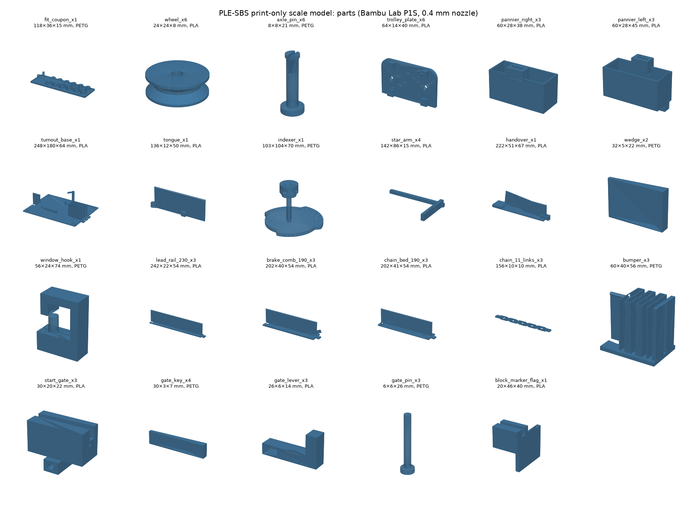

## Version 2 (30 June 2026)

The first set of parts, printed on 27 June, did not go together: the spacer pegs and the pannier dovetails missed their plates, the axle holes drooped because the plates printed standing on edge, and on the turnout the star arms swept through the lanes. Version 2 was redesigned around one rule: every working height comes from where the wheel's V-groove seats on the 1.5 mm wire and on the 3.5 mm rail head, so the wire, the wagon, the rails and the yard agree by construction. It was then checked part against part before anything was sliced. Version 1 is kept in `check/make_parts_v1.py` with its audit, `check/audit_v1.py`.

## How it works

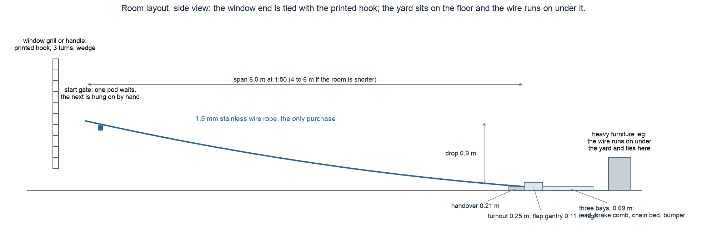

The wire runs from a printed hook on a window grill or handle down to the handover on the floor, 6 m away and 0.9 m lower, and on under the yard to a furniture leg. A pod waits behind the start gate near the top; lift the lever and it rolls down on two V-groove wheels, over the handover, onto a printed blade rail. The wheel sits at the same height on the wire and on the head, so the handover has no step.

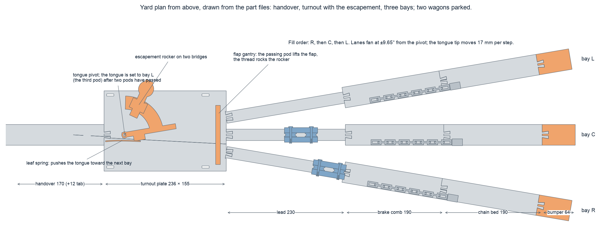

On the turnout plate a pivoting tongue sends the pod down one of three lanes that fan out at ±9.65°. Each lane is a bay: a lead rail, a brake comb (twelve leaves the basket floor presses down 1.8 mm), a chain bed (the left basket meets a sled and pushes it and a print-in-place chain), and a zig-zag bumper as the backup stop.

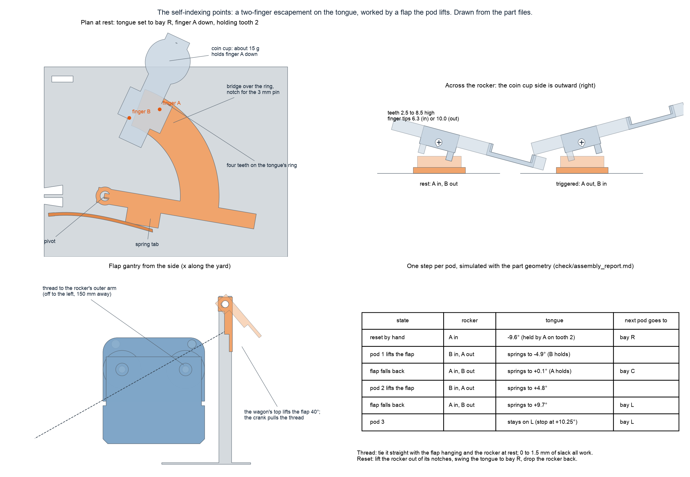

The self-indexing points are a two-finger escapement. A leaf spring pushes the tongue toward bay L; a ring of four teeth on the tongue stops it wherever a finger of the rocker above is down. At rest finger A is down, held by the coins in the rocker's cup, and the tongue rests on a tooth at bay R. When a pod has left the tongue it passes under a flap; the flap swings 40°, its crank pulls a thread, the rocker tips, finger A lifts and finger B drops, and the tongue springs half a step until B catches the next tooth. When the flap falls back, B lifts, A drops into the gap, and the tongue springs the other half step: bay C. The next pod moves it to bay L. The simulation in `check/assembly_report.md` steps it R, C, L to within 0.1° of each lane, and works for any thread slack from 0 to 1.5 mm. No power, no sensors; the full-size design in the paper does the same job with a ratchet at the points.

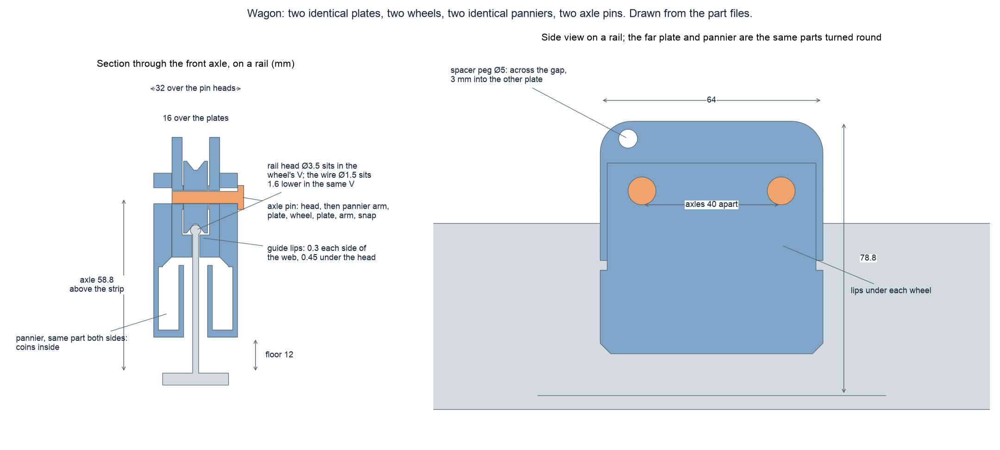

A wagon is two identical plates, two wheels, two identical panniers and two axle pins. Each pin passes through a pannier arm, a plate, a wheel, the other plate and the other arm, so the pins both carry the wheels and clamp the panniers. Spacer pegs cross the gap between the plates. Short lips under each wheel straddle the rail web with 0.3 mm each side and reach 0.45 mm under the head; on the wire they hang 2.4 mm below it.

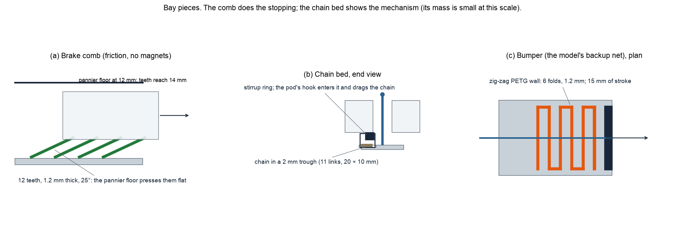

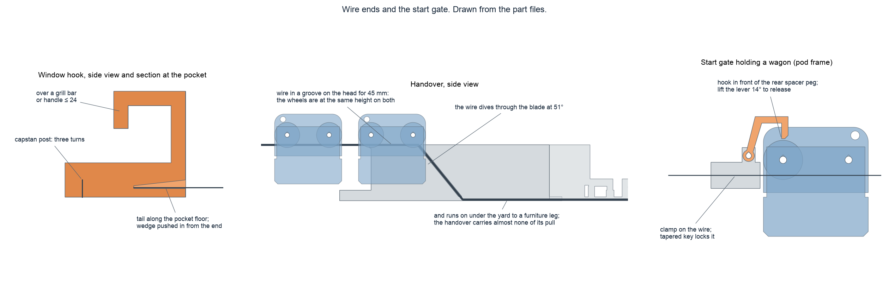

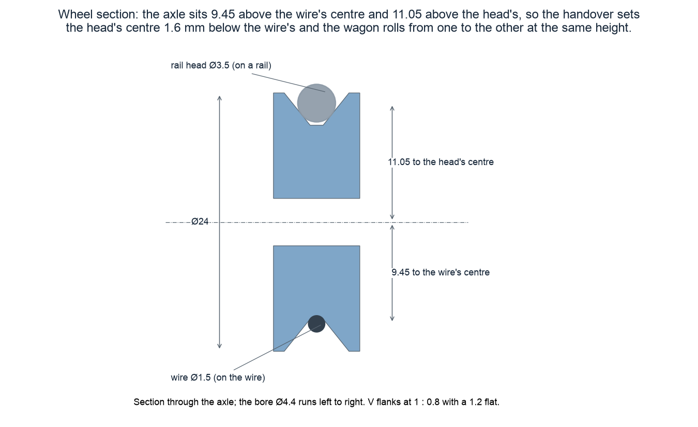

## Dimensions at a glance

Full-size values are the paper's worked example (design D5); the model is 1:50 for the wire and the pods, and the yard is compressed in length.

| Item | Full size | At 1:50 | Model as printed |
|---|---|---|---|
| Wire rope | 36 mm, 300 m span, 45 m drop | 0.72 mm, 6.0 m, 0.90 m | 1.5 mm stainless, 6.0 m span, 0.90 m drop |
| Pod, outside | about 3 m long, 4 seats | 60 mm | 64 long × 32 wide over the pin heads × 79 high on the rail |
| Pod mass | 300 kg empty, 700 kg with 4 people | 2.4 g / 5.6 g | about 60 g printed + 100 to 500 g of coins; mass is not scaled and need not be |
| Wheel | sheaves ≥ 40 × rope | | Ø24, 8 wide, V-groove at 1 : 0.8 with a 1.2 flat |
| Turnout | | | plate 236 × 155 × 4; tongue 100 long, tip moves 17 mm per step; lanes ±9.65° |
| Escapement | | | four teeth on a ring r 51.5 to 73; rocker on a 3 mm pin 15.3 above the plate; trigger flap 30 long on a gantry 100 high |
| Bay | 30 m lead + 60 m brake + 50 m chain bed + 3 m net = 143 m | 2.9 m | 230 lead + 190 comb + 190 chain bed + 64 bumper = 674 |
| Brake | 60 m eddy-current, k ≈ 314 N·s/m | 1.2 m | friction comb: 12 leaves, 30 long, 1.2 thick, 25°, tips 13.8 high |
| Chain | 40 kg/m picked up over 50 m | | sled plus 11 printed links 20 × 10 |
| Bays at the bumpers | | | 146 mm apart, centre to centre |
| Whole yard | | | 1.1 m long, 0.35 m wide at the bumpers, rail head 52 mm above the floor, gantry 109 mm |

## Sizing to the room (tie point 2 m high)

`layout.py` sizes the wire to the room: `.venv/bin/python scale_down/layout.py --tie 2.0 --floor 8.0`. The parts do not change; only where the wire is tied and how far the yard sits from it.

With a 2 m tie point the height is not the limit, the floor is. The worked example's slope (300 m span over a 45 m drop, about 1 in 6.7) at a 2 m drop would need a 13 m span and a 2.5 m yard, so the true-to-scale options are:

| Scale | Span | Drop | Floor needed | Ride | Arrival |
|---|---|---|---|---|---|
| 1:50 | 6.0 m | 0.90 m | 7.7 m | 3.3 s | 3.5 m/s |
| 1:35 | 8.6 m | 1.29 m | 10.7 m | 4.0 s | 4.1 m/s |
| 1:25 | 12.0 m | 1.80 m | 14.8 m | 4.8 s | 4.6 m/s |

Recommendation: stay at 1:50 (the printed parts as they are), tie the wire about 0.96 m above the floor for the to-scale run, and use the rest of the 2 m for an experiment the paper could not do on a real pad: keep the span at 6 m and raise the tie point in steps (0.5, 0.7, 0.9, 1.2, 1.5, 1.9 m). Each step is a different crew access height at the same span, which is one row of Figure 4's sizing map (25 to 97 m full size). Measure the arrival speed and whether the comb stops the pod inside its bay; the slope where it no longer does is the model's "stop too hard" edge, and the shallowest slope where a light pod still reaches the yard is its "stall" edge.

If the floor is shorter than 7.7 m, shorten the span and accept a steeper wire; a 4 m span with a 0.9 m drop is about 1 in 4.4, the left side of the band in Figure 4, and the pods will arrive faster than scale.

## Build order

1. **Print the coupon and settle `CLR`.** See BOM section 4.
2. **Build one wagon.** Lay a plate peg-up, drop a wheel over each axle hole, put the second plate on (turned 180°, its peg into the first plate's hole). Hang a pannier on each side with its arm against the plate, then push each axle pin through from the right: pannier arm, plate, wheel, plate, arm, until the split end snaps. Put the same coins in both panniers.
3. **Lay the yard.** Handover, turnout, then along each lane lead, comb, chain bed, bumper, joined by the dovetails. Weight the turnout plate and the handover with books.
4. **Fit the points.** Follow BOM section 7, steps 3 to 6: tongue, spring, rocker with about 15 g in its cup, flap, thread. Lift the flap by hand twice and watch the tongue step R, C, L; then reset it to R.
5. **Lay the sleds and chains.** In each chain bed, the sled in the trough just past the start, open side up with a few coins in it, and the chain in the trough ahead of it.
6. **Rig the wire.** At the window: three turns round the hook's capstan post, the tail along the pocket floor, the wedge pushed in from the open end until it grips (about 8 mm of it stays out), then hang the hook. At the floor: lay the wire in the groove on the handover's head, down the dive slot, along the groove under the handover and the turnout, and on to the furniture leg. Pull it to the sag in BOM section 1 and tie it off.
7. **Set the gate.** Drop the wire into the gate's slot about 0.3 m from the hook and push the key in beside it until it grips. Hang a wagon on the wire below the gate (the wire goes through the slot between the lips), push it back until the lever's hook drops in front of its rear spacer peg.
8. **Run.** Points at bay R. Lift the lever (14° frees the wagon). When it has stopped in bay R, hang the next wagon behind the gate and release it: bay C. The third goes to bay L. Reset: lift the pods out, push the sleds and chains back, reset the points to R.

## Tuning

- **Too fast into the bumper:** more coins (the comb's friction grows with weight), or more coins in the sled.
- **Stops in the lead or the comb:** fewer coins, or snip every second comb leaf.
- **Pod stalls on the wire:** more drop or less sag; the real system has the same problem, that is the point of Figure 4 in the paper.
- **Points do not step:** the thread is too slack (more than 1.5 mm) or the cup has too few coins to bring finger A back down; shorten the thread or add a coin.
- **Tongue stops short of a lane:** a seam bump on a tooth or a finger; scrape it, then graphite.
- **Wagon catches at the tongue:** the wheels ride up about 0.14 mm crossing the joint at the pivot, which is normal; a real catch means the tongue is not resting on its tooth (check the coin cup) or a seam bump on the tongue's head; scrape it.

## Pictures

`render_yard.png`, `render_turnout.png` and `render_pod.png` are renders of the assembled part files (made by `make_renders.py`); the paper's Figure 8 and the poster use them. Photographs of the printed model go in `photos/` (see the note there) and can replace the renders by changing one file name each.

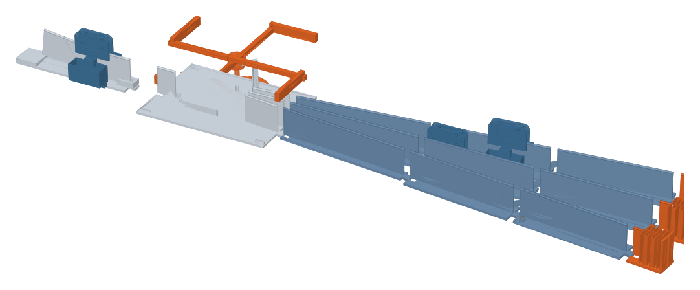

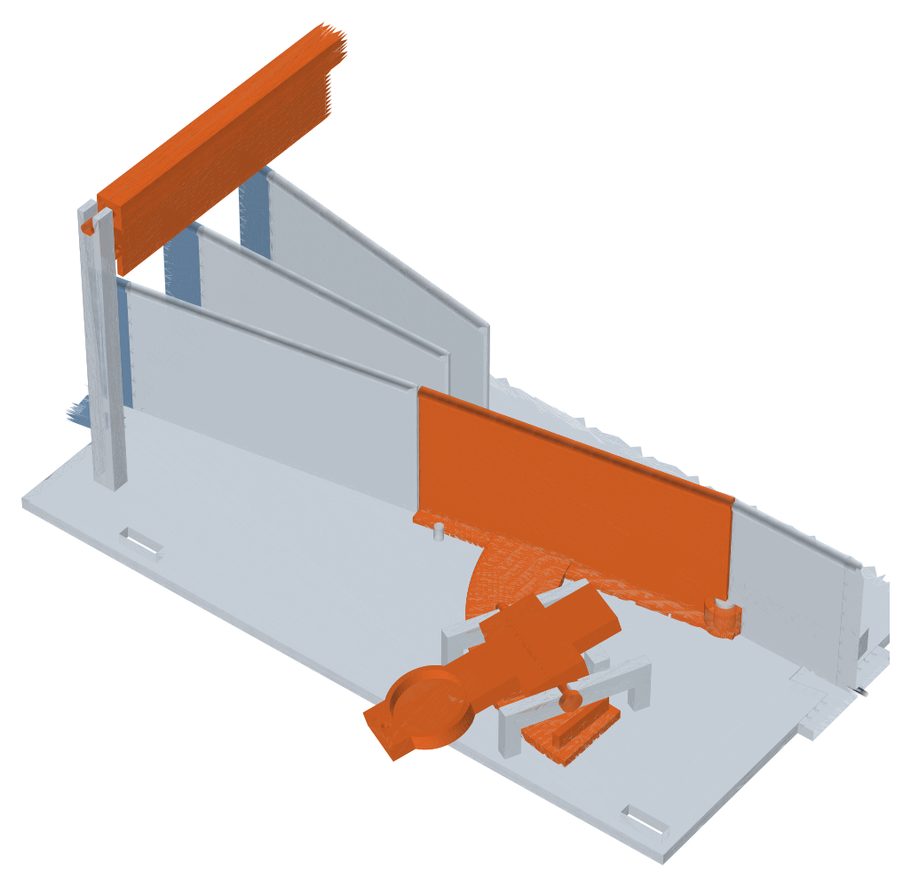

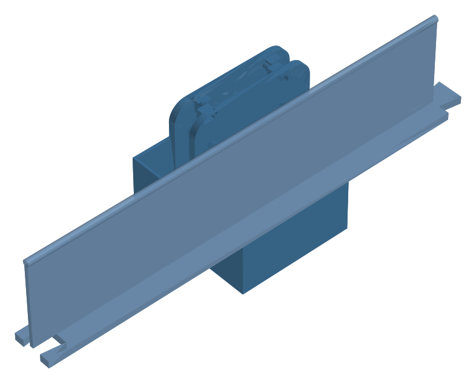

## Build log and test results

- `results.csv` is the run log: one row per release with pod mass, span, drop, time to the handover, time to a stop, the bay reached, whether the points indexed correctly, and the stop distance in the bay. The simulator's Scale model tab fits μ and the drag area from the `release_to_handover_s` column.
- The switch-yard test is pass/fail per run: pod 1 to bay R, pod 2 to bay C, pod 3 to bay L, points indexed by the pods themselves, every pod stopped before the bumper.

## What to measure

The protocol in `docs/scale-model-protocol.md` applies: time each run on slow-motion video, three repeats per setting, and fit the rolling resistance with the simulator's Scale model tab. New here: the time from release to a stopped pod in each bay, and the headway you can run between pods on the one wire with the yard against a single dock (hold pods 2 and 3 in bay 2 to imitate a dock).

## Honesty

This is a demonstration of the mechanism, not a calibrated brake. The brake comb is friction, the chain is too light to matter at this scale, and the bay lengths are compressed. The wire, the pods and the sag are to scale (1:50, Froude), and those are what the protocol measures. The flap-and-escapement is my model-scale substitute for the ratchet at the points in the paper. The fit check proves the parts go together and the mechanism steps in the computer; whether the spring, the coins and the thread give the right forces is for the first runs to show.

## Regenerate

```bash
.venv/bin/python scale_down/make_parts.py               # STLs, parts.csv, parts_preview.png
.venv/bin/python scale_down/check/assembly_check.py     # fit and motion report
.venv/bin/python scale_down/check/freecad_export.py     # then, in FreeCAD:
/Applications/FreeCAD.app/Contents/Resources/bin/freecadcmd -c "exec(open('scale_down/check/freecad_check.py').read())"
.venv/bin/python scale_down/make_drawings.py            # sketch_*.png
.venv/bin/python scale_down/make_renders.py             # render_*.png
.venv/bin/python scale_down/make_print_pack.py <names>  # re-slice those parts for the P1S
```
