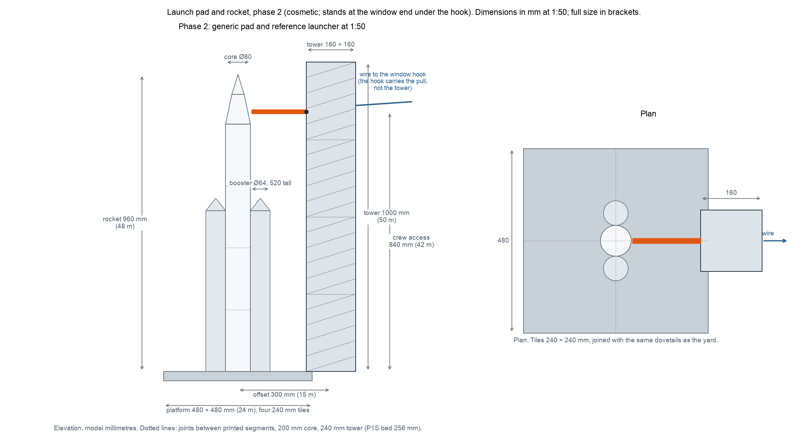
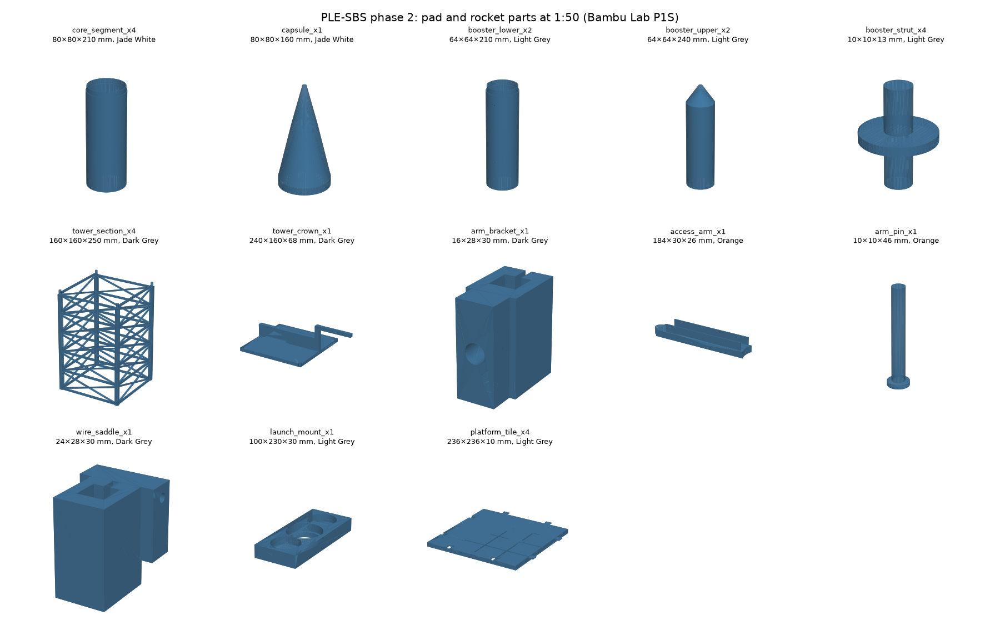
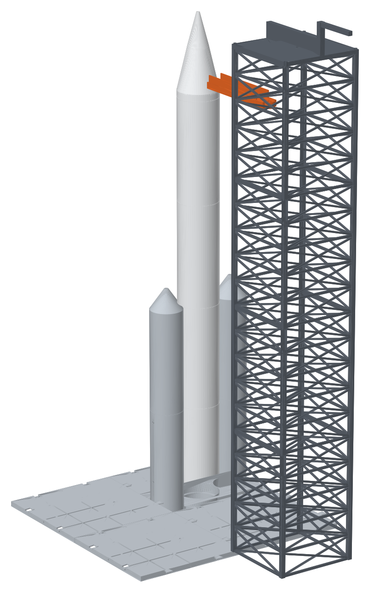

# Phase 2: launch pad and rocket at 1:50

A cosmetic model of the generic pad from the paper (reference medium-lift launcher, crew access level 42 m, tower 15 m from the rocket), printed in segments that fit the P1S bed and assembled by hand. It stands at the window end of the wire, under the hook. The wire's pull goes to the window hook; the printed tower carries nothing. Dimensions: [sketch_8_pad_phase2.png](sketch_8_pad_phase2.png).

## Dimensions (model mm, full size in brackets)

| Item | Model | Full size |
|---|---|---|
| Rocket overall height | 960 | 48 m |
| Core diameter | 80 | 4.0 m |
| Boosters, two | Ø64 × 520 | 3.2 m × 26 m |
| Capsule and nose | 160 tall | 8 m |
| Tower | 160 × 160 × 1000 | 8 × 8 × 50 m |
| Crew access level | 840 above the platform | 42 m |
| Access arm | 300 long × 12 wide | 15 m |
| Tower offset from the rocket | 300 | 15 m |
| Launch platform | 480 × 480 × 30 | 24 × 24 m |

## Printed parts

Files are in `stl_phase2/`, generated by `make_pad_parts.py`; `pad_parts.csv` is the same table; preview `pad_parts_preview.png`; assembled render `render_pad.png`. 27 pieces, about 1.7 kg.

| File | Qty | Size (mm) | Filament | Colour | g each | What it is |
|---|---:|---|---|---|---:|---|
| core_segment_x4 | 4 | Ø80 × 210 | PLA Basic | Jade White | 50 | 200 mm tube with a spigot on top; strut holes |
| capsule_x1 | 1 | Ø80 × 160 | PLA Basic | Jade White | 50 | frustum and nose, socket for the spigot |
| booster_lower_x2 | 2 | Ø64 × 250 | PLA Basic | Light Grey | 50 | tube with spigot |
| booster_upper_x2 | 2 | Ø64 × 240 | PLA Basic | Light Grey | 55 | tube with the nose |
| booster_strut_x4 | 4 | 10 × 10 × 13 | PLA Basic | Light Grey | 1 | double peg joining booster to core |
| tower_section_x4 | 4 | 160 × 160 × 250 | PLA Basic | Dark Grey | 110 | lattice, pegs up, holes down |
| tower_crown_x1 | 1 | 240 × 160 × 68 | PLA Basic | Dark Grey | 60 | cap with crane |
| arm_bracket_x1 | 1 | 16 × 28 × 30 | PLA Basic | Dark Grey | 8 | clips onto a corner post at 840 mm |
| access_arm_x1 | 1 | 184 × 30 × 26 | PLA Basic | Orange | 45 | swings on the pin to the capsule |
| arm_pin_x1 | 1 | Ø6 × 46 | PETG HF | Orange | 2 | pivot pin |
| wire_saddle_x1 | 1 | 24 × 28 × 30 | PLA Basic | Dark Grey | 10 | clips onto a post; the wire leaves the tower here |
| launch_mount_x1 | 1 | 100 × 230 × 30 | PLA Basic | Light Grey | 80 | three pockets hold core and boosters |
| platform_tile_x4 | 4 | 248 × 248 × 10 | PLA Basic | Light Grey | 150 | tile, ribs below, dovetails |

Assembly: stack the four tower sections on their pegs, crown on top; clip the arm bracket and the wire saddle to the corner post nearest the rocket at 840 mm; pin the arm. Stack the core on the launch mount, capsule last; boosters into their pockets, struts through the holes. Tiles join with the dovetails; the mount sits on the centre of the platform. The platform is optional and is a third of the filament.

## Filament for phase 2

| Colour | Filament | Parts | Printed mass |
|---|---|---|---:|
| Jade White | PLA Basic | core, capsule | 250 g |
| Light Grey | PLA Basic | boosters, struts, launch mount, platform tiles | 894 g |
| Dark Grey | PLA Basic | tower, crown, bracket, saddle | 518 g |
| Orange | PLA Basic | access arm | 45 g |
| Orange | PETG HF | arm pin | 2 g |

## Phases 1 and 2 combined, as sliced

Exact figures from OrcaSlicer with the P1S 0.4 mm profiles (`print_pack/README.md`); the earlier estimates were low because the lattice tower, the comb teeth and the solid mechanism parts carry more wall than infill.

| Colour | Filament | Phase 1 | Phase 2 | Used | Used + 20 % | Buy |
|---|---|---:|---:|---:|---:|---|
| Light Grey | PLA Basic | 698 | 1,185 | 1,883 | 2,260 | 3 spools (2 without the platform tiles) |
| Dark Grey | PLA Basic | 0 | 804 | 804 | 965 | 1 spool |
| Jade White | PLA Basic | 0 | 476 | 476 | 570 | 1 spool |
| Cobalt Blue | PLA Basic | 194 | 0 | 194 | 235 | 1 spool |
| Orange | PLA Basic | 84 | 45 | 129 | 155 | 1 spool |
| Orange | PETG HF | 198 | 2 | 200 | 240 | 1 spool |
| **Total** | | **1,174** | **2,511** | **3,685** | **4,425** | **8 spools, 8 kg** (7 without the tiles) |

Printing time from the slicer: phase 1 about 35 hours, phase 2 about 65 hours, of which the tower sections are 25 hours and the platform tiles 12.

## Making the mechanisms work first time

The moving parts are all in phase 1: wheels on pins, the dovetails, the tongue on its post, the cam and star, the detent finger, the chain, the gates. Phase 2 adds only the arm pivot.

1. **Dry filament, one spool per mechanism.** Mechanism parts shrink with the filament and the temperature; print the indexer, tongue, star arms and pins from the same spool in one session.
2. **Print the fit test before anything else.** One wheel, one pin, one plate, one wedge and one gate key, in the final filaments. The pin must turn freely with slight side play; the dovetail must push on firmly by hand. If it binds, raise `CLR` in `make_parts.py` from 0.2 to 0.3; if it rattles, lower it to 0.15. Reprint the test, then the rest.
3. **Kill the elephant's foot.** The first layer spreads, and that is what makes pins stick and dovetails jam. In Bambu Studio set the first-layer flow to 0.95 and enable "elephant foot compensation" at 0.15 mm, or print mechanism parts on a brim and trim it.
4. **Layer height 0.12 mm for the cam, pins, wheels and chain;** 0.2 mm elsewhere. The cam's dwell steps and the pin's snap tip need the finer layers.
5. **Orientation as listed in BOM.md.** Pins standing on the head, wheels flat, indexer standing on the cam, star arms flat, chain flat. A pin printed lying down has layer lines across it and snaps.
6. **PETG HF for everything that flexes or snaps**, PLA for everything that must stay stiff and square. Do not swap them.
7. **Run in by hand.** Turn the star through twenty cycles, slide each pod the length of each bay, and flick each gate ten times before the first run. A trace of candle wax or PTFE spray on the cam rim, the pin shanks and the points is allowed; it is not a purchase if you have it.
8. **Set the tongue.** With the star at rest in each notch, the tongue tip must sit within 0.5 mm of its exit rail. Shave the follower boss or add tape to it; the sketch gives the three positions.
